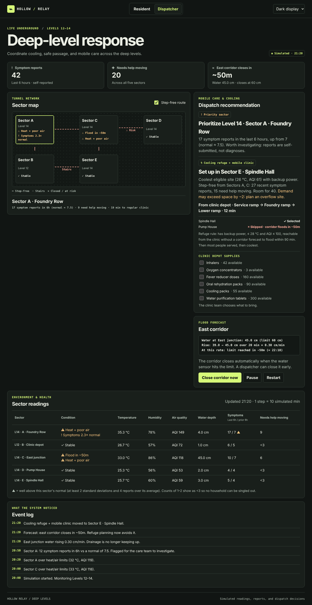
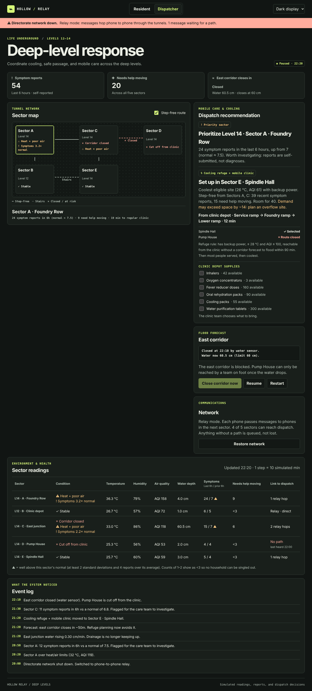
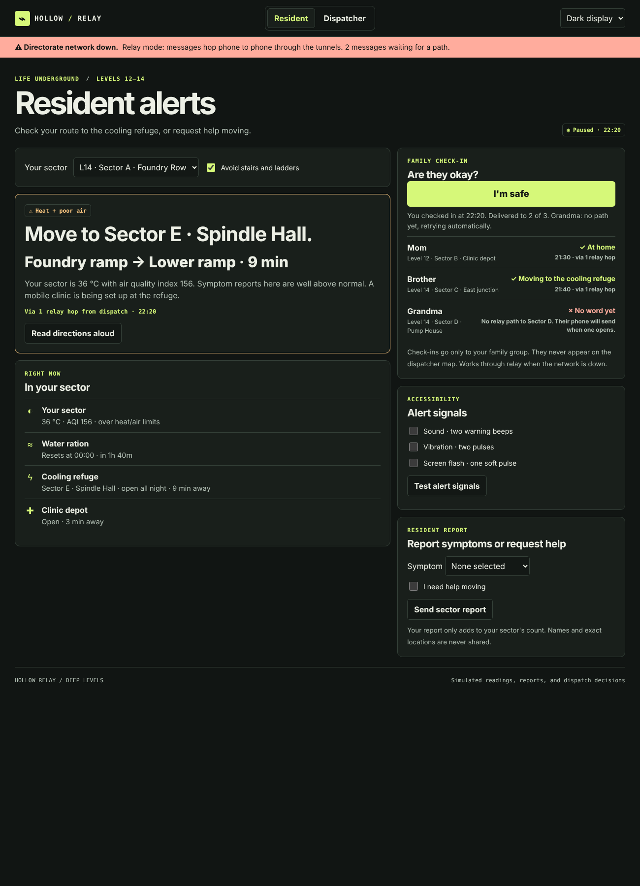

# Hollow Relay

**Life Underground hackathon track.** Two billion people live in the Hollow, a network of tunnels under a dead surface. In the deep levels the heat is rising, sewage floods the tunnels, lung sickness is spreading, and medicine runs out first.

Hollow Relay is an emergency response console for Levels 12–14. It follows each problem from cause to response: **dangerous conditions → people getting sick → help sent where it's needed.**



## Problems it solves

| # | Track problem | What Hollow Relay does |
|---|---|---|
| 3 | The deep levels are overheating | Monitors temperature and air quality, picks the **coolest eligible site** as a powered cooling refuge, and routes residents to it |
| 5 | Sewage and flooding cut off tunnels | Forecasts **when** a corridor will flood from the water's rise rate, shows the math, closes it automatically at the limit, and reroutes everyone in advance |
| 9 | Lung sickness doesn't match official numbers | Residents report symptoms anonymously. Each sector is compared with **its own normal**, and spikes are flagged for investigation |
| 10 | Medicine runs out far from clinics | Names a **priority sector**, sets up a mobile clinic at the refuge, gives the dispatcher a route from the clinic depot, and lists the supplies available to pack |
| 7 | The Directorate can shut the network down | **Relay mode:** alerts, readings and reports hop phone to phone through the tunnels. Anything without a path is queued, not lost, and syncs when one opens |
| 8 | Families split across levels can't check on each other | One-tap **"I'm safe"** check-in and a family screen showing who's okay, when they checked in, and how many hops the message took |

## How it works

**Flood forecast.** The system takes the last 30 minutes of water-depth readings at East junction, computes the rise rate in cm/min, and extrapolates to the 60 cm closure limit:

```
Rise: 39.0 → 45.0 cm over 20 min = 0.30 cm/min
At this rate: limit reached in ~50m (≈ 22:10)
```

Once the forecast drops under 90 minutes, routing stops sending people through that corridor, so the refuge moves *before* the flood instead of after it.

**Symptom spike detection.** Every sector has a history of report counts for past 6-hour windows. The current window is flagged when it's at least 2 standard deviations **and** 4 reports above that sector's average, e.g. *"17 reports in the last 6 hours, up from 7 (normal ≈ 7.5)"*. Reports are self-submitted, so a flag means "investigate", not "outbreak confirmed".

**Refuge and clinic placement.** Candidate sites have backup power. A site qualifies if it's at most 28 °C, has AQI ≤ 100, and can be reached from the clinic depot without a corridor that's about to flood. The system picks the site that serves the most people in hazard sectors, breaking ties by coolest. If demand exceeds the site's capacity, it says so.

**Relay mode.** When the Directorate network goes down, each phone passes messages to phones in the neighboring sector, so a message gets through only where people can physically walk. The dispatcher sees each sector's hop count. Sectors with no path show their **last-heard** readings instead of pretending to be live. Reports from a cut-off sector are saved on the phone and sync automatically when a path opens or the network returns.

**Family check-in.** One tap sends "I'm safe" to your family group, and only to them. It never appears on the dispatcher map. Each family member shows their status, time, and how the message arrived ("via 1 relay hop"), or "No word yet · no relay path to Sector D" when they can't be reached.

**Right now card.** Even when nothing is wrong, the resident screen shows your sector's conditions, when your water ration resets, the nearest cooling refuge, and how far the clinic is.

**Routing.** Shortest-path search over the tunnel graph. A step-free option avoids stairs and ladders for wheelchair users, people with breathing problems and older residents.

## Designed for people underground

- **Dark, amber-night and text-only modes.** After a lifetime underground, bright screens hurt dark-adapted eyes, and the text-only mode saves power during blackouts.
- **No color-only signals.** Every status has an icon and a word.
- **Alerts don't need a screen:** sound, vibration and screen-flash options, plus "Read directions aloud".
- **Screen-reader labels and live announcements** for blind and low-vision residents.
- **"I need help moving" requests** show up as per-sector counts on the dispatcher view.

## Privacy
- Family check-ins go only to the family group, never to the dispatcher.

- Only **sector totals** are shown, never individual reports, names or exact locations.
- Counts of 1–2 are shown as **"<3"** so a single household can't be identified.
- This matters in the Hollow: the Directorate controls the network, and people won't report if they can be traced.

## Demo script (≈ 45 seconds)

The simulation runs on its own: one step every 3 s = 10 simulated minutes.

| Time | What happens |
|---|---|
| 20:00 | Sector C is hot with poor air. The refuge is set up at Pump House (coolest site). |
| 20:20 | Sector A crosses heat/air limits. |
| 20:50 | Sector A's symptom reports spike above normal → it becomes the priority sector. |
| 21:20 | East junction drainage falls behind. The forecast drops to ~50 min, so the refuge **moves to Spindle Hall before the flood**. |
| 22:10 | Water hits 60 cm and the corridor closes automatically. Pump House residents are told to request help. |
| any time | Click **Simulate network shutdown**. Hop counts appear, Pump House goes to "No path · last heard", and Grandma's check-in shows "No word yet". Click **Restore network**: queued reports sync and her "Needs help moving" check-in arrives. |

Switch to the **Resident** view to see each sector's alert. Use **Pause / Restart / Close corridor now** to control the drill.





## Run it

No build step. Open `dist/index.html` in a browser, or serve the folder:

```bash
cd dist && python3 -m http.server 8000
```

## Files

- `dist/index.html`: layout for the dispatcher and resident views
- `dist/relay.js`: simulation, forecasting, spike detection, routing and alerts
- `dist/style.css`: dark / amber / text-only themes

All readings, reports and dispatch decisions are simulated.
